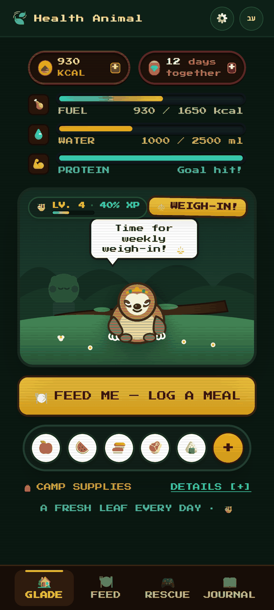
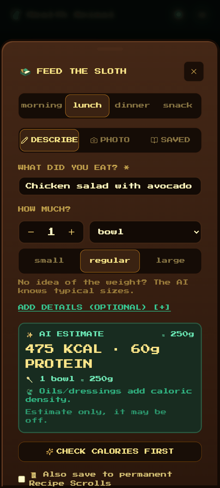
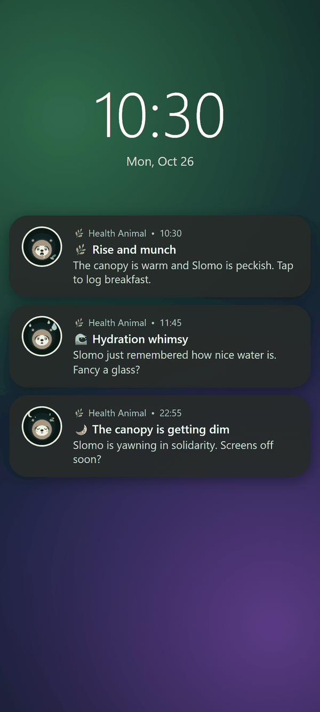
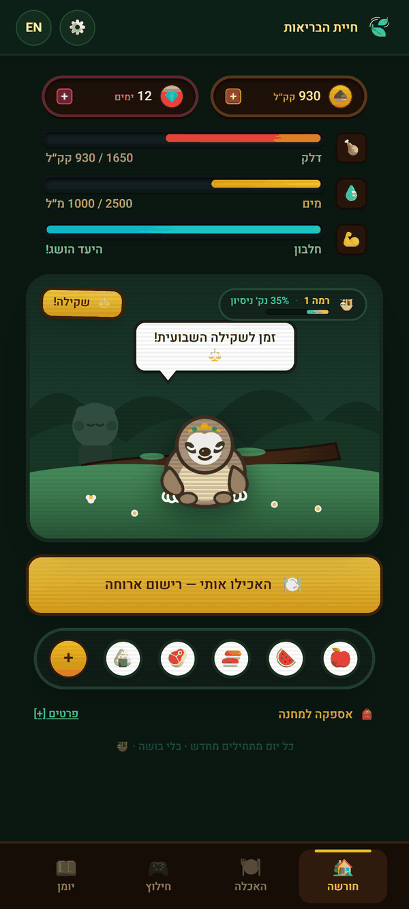

# Health Animal

A whimsical, anti-shame **sloth Tamagotchi copilot** for tracking calories, water and sleep, whether you are
losing, gaining or maintaining weight. Your sloth reacts to how your day goes; there is no guilt, only gentle nudges.

> Not medical or nutritional advice. This is a playful tracker; it does not replace a doctor, registered dietitian or nutritionist. See [Disclaimer](#disclaimer).

## Features

- Meal logging with AI calorie estimates (text and photo), with an offline estimator as a fallback
- Daily calorie range, water and sleep tracking
- A sloth mascot whose mood follows your day
- Goals for losing, gaining or maintaining weight, with a fuel planner
- Weigh-ins and progress history
- "Rescue" suggestions: surprise dishes that fit what is left (or still to eat) today
- Saved recipes, reminders, English and Hebrew (RTL)
- Android app that keeps all data on the phone

## Architecture

- **Web + server mode**: React/Vite client served by an Express + Prisma (SQLite) server. Accounts live on the server.
- **Phone-local mode**: the Android app (Capacitor) bundles the same client. `client/src/local/` answers every
  `/api/...` call from on-phone storage, so no server or login is needed. Only the AI question can leave the phone.
- Shared AI prompts live in `shared/aiPrompts.mjs`, used by both the server and the phone.

## Screenshots

| Dashboard | Log a meal | Reminders | Hebrew (RTL) |
| --- | --- | --- | --- |
|  |  |  |  |

## Self-hosting

**There is no hosted instance. Everyone runs their own server.** You can also skip the server entirely and
build the [Android app](#android), which keeps all data on the phone.

Requirements: **Node.js 20 or newer** (`nvm use` reads `.nvmrc`), npm and git. Docker is optional.

| What | Port |
| --- | --- |
| Server (API, and the built web app in production) | 5000 (`PORT`) |
| Vite dev server (development only) | 5173 |
| Docker (published on the host) | 8090 |

### Quick start (development)

```bash
git clone <this repo's URL> health-animal
cd health-animal
npm run install:all                      # root, server and client dependencies
cp server/.env.example server/.env       # Windows cmd: copy server\.env.example server\.env
                                         # PowerShell:  Copy-Item server/.env.example server/.env
npm run db:push                          # creates the SQLite file server/prisma/dev.db
npm run dev                              # server on :5000 + Vite on :5173
```

Open <http://localhost:5173>. The Vite dev server proxies `/api` to the server on port 5000.
Without a `GEMINI_API_KEY` the app still works, using the offline calorie estimator.

**First account:** on the login page tap "New here?" and register with a name. That name is your login
(there are no passwords). To use the app from your phone's browser on the same Wi-Fi, open
`http://<your computer's LAN IP>:5173`.

Optional: `npm run db:seed` creates a demo account with a week of sample data. Log in as
`demo@healthanimal.app` (any password is accepted; the server ignores it). Running it again resets that account.
It is not needed for normal use.

### Production without Docker

Verified on Node 20. The server serves the built web app and the API on one port.

```bash
npm run install:all
cp server/.env.example server/.env       # then edit it: set JWT_SECRET (and GEMINI_API_KEY)
npm run db:push
npm --prefix client run build            # writes client/dist
NODE_ENV=production npm --prefix server start
```

Open <http://localhost:5000>. With `NODE_ENV=production` the server refuses to start unless `JWT_SECRET` is set
to something other than the placeholder. Generate one with:

```bash
node -e "console.log(require('crypto').randomBytes(32).toString('hex'))"
```

Windows: PowerShell uses `$env:NODE_ENV="production"; npm --prefix server start`; cmd uses
`set NODE_ENV=production&& npm --prefix server start`. Or put `NODE_ENV=production` in `server/.env`.

Run it under a process manager (systemd, pm2) to keep it alive. For correct "today" boundaries, run it with
your local time zone (the server uses the machine's `TZ`).

### Docker

Not verified by the maintainer (it follows the `Dockerfile` and `docker-compose.yml`):

```bash
cp server/.env.example .env      # in the project ROOT this time; edit it (JWT_SECRET, GEMINI_API_KEY...)
docker compose up -d --build
```

Open `http://localhost:8090`. Notes:

- The container listens on 5000 internally and is published on host port **8090**.
- Data lives in the named volume `health_data` (the SQLite file `/data/health.db`). The schema is applied
  automatically on start.
- `NODE_ENV=production`, `PORT` and `DATABASE_URL` are set by Docker; you do not need them in `.env`.
- Set your time zone so "today" starts at local midnight: add `TZ=Europe/London` (your zone) to the root `.env`
  or export it in your shell before `docker compose up`. The default is UTC.
- The compose file publishes on all interfaces. Edit the `ports:` line to your LAN/VPN address, or to
  `127.0.0.1:8090:5000` behind a reverse proxy.

### Environment variables

Server variables go in `server/.env` (Docker: `./.env` in the project root). See `server/.env.example`.

| Variable | Used by | Meaning |
| --- | --- | --- |
| `GEMINI_API_KEY` | server | Google Gemini key for AI estimates. Free key: <https://aistudio.google.com/apikey>. Without it the offline estimator is used. |
| `JWT_SECRET` | server | Signs login tokens. Must be a real secret (not the placeholder) when `NODE_ENV=production`. |
| `NODE_ENV` | server | Set to `production` when deploying (Docker does this). |
| `PORT` | server | Server port, default `5000`. If you change it in development, also set `VITE_API_BASE_URL` so the proxy follows. |
| `DATABASE_URL` | server, Prisma | SQLite location, default `file:./dev.db` (relative to `server/prisma/`). Docker uses `file:/data/health.db`. |
| `APP_KEY` | server | Optional shared key (24+ characters) that lets your own Android build ask this server for AI estimates. |
| `GEMINI_MODEL` | server | Optional preferred Gemini model, tried before the built-in defaults. |
| `ALLOW_REGISTER` | server | Set to `false` to close sign-ups. |
| `TRUST_PROXY` | server | Set to `1` behind a reverse proxy so rate limits see real client IPs. |
| `TZ` | Docker / OS | Time zone for "today". Read by Docker Compose (default `UTC`) and by Node from the OS; the app does not read it from `server/.env`, so set it in the environment or in the Docker root `.env`. |
| `VITE_API_BASE_URL` | client | API origin for a web build served from a different origin than the server. Also the dev proxy target in `client/vite.config.js` (default `http://localhost:5000`). |
| `VITE_AI_SERVERS` | client (Android build) | Comma-separated addresses of your server for the Android app. |
| `VITE_APP_KEY` | client (Android build) | Must equal the server's `APP_KEY`. Baked into the APK. |
| `VITE_APK_DOWNLOAD_URL` | client | Optional link shown on the web Settings page. Empty hides it. |

`VITE_*` variables go in `client/.env.local` (see `client/.env.example`) and apply at build time.

### Security

Web login has no passwords; the name is the login. If you host a server, keep it on your own private network
(home network or your own VPN). Never expose it to the public internet. After creating your accounts, set
`ALLOW_REGISTER=false` and restart.

### Backup

- Server, non-Docker: copy `server/prisma/dev.db` (or the path in `DATABASE_URL`), ideally with the server stopped.
- Server, Docker: `docker compose cp app:/data/health.db ./health-backup.db`, or back up the `health_data` volume.
- Phone app: **Settings → Data on this phone → Backup to file**, then share the file somewhere safe.

### Updating

```bash
git pull
npm run install:all
npm run db:push                     # applies schema changes
npm --prefix client run build       # then restart the server
```

Docker: `git pull && docker compose up -d --build` (the schema is applied on start).

Android: build the new APK and install it **over** the old one. It must be signed with the same key as before
(your machine's debug key, see [mobile/README.md](mobile/README.md)). Uninstalling first deletes the data on the
phone, so back up first.

### Troubleshooting

- **`npm run db:push` says the environment variable `DATABASE_URL` is not found**: you skipped
  `cp server/.env.example server/.env`.
- **The server crashes with `EADDRINUSE` on port 5000** (the dev page then shows proxy errors): something else
  uses port 5000 (on macOS, AirPlay Receiver). Set `PORT=5055` in `server/.env` and start with
  `VITE_API_BASE_URL=http://localhost:5055 npm run dev` (PowerShell:
  `$env:VITE_API_BASE_URL="http://localhost:5055"; npm run dev`).
- **"JWT_SECRET is missing or still the placeholder"**: you are in production mode; set a real secret in `.env`.
- **AI estimates are always offline**: `GEMINI_API_KEY` is empty, still the placeholder, or invalid. Restart the
  server after editing `.env`; the startup log says whether a key was found.
- **Meals land on the wrong day**: set `TZ` (see above). Docker defaults to UTC.
- **Phone cannot reach the server**: use the computer's LAN IP, allow the port through the firewall, and make
  sure both are on the same network.

## Android

Build your own APK; see [mobile/README.md](mobile/README.md). AI options in the app:

1. **Your own Gemini key**, pasted in Settings (no server at all).
2. **Your own server**, via `VITE_AI_SERVERS` + `VITE_APP_KEY` at build time.
3. **Neither**: offline estimates.

## Security and privacy

- On the phone, your data stays on the phone.
- With your own key, food text and photos go straight to Google Gemini. With a server, they go to your server and then to Gemini.
- APKs embed `APP_KEY`, so never publish an APK built with your key or server address.
- Web login has no passwords; the name is the login. Keep your server on a private network or your own VPN,
  never on the public internet, and set `ALLOW_REGISTER=false` once your accounts exist.
- Not medical advice (see [Disclaimer](#disclaimer)).

## Contributing

- Every `t()` string needs a Hebrew translation: run `npm run check:i18n` in `client`.
- Keep `client/src/local/localApi.js` in sync with the server routes.
- The AI prompts live in `shared/aiPrompts.mjs`.
- By submitting a contribution you grant the author the right to use it, including commercially, and to relicense it.

## Disclaimer

- Health Animal is not medical or nutritional advice.
- It does not replace a doctor, registered dietitian or nutritionist.
- AI and offline calorie estimates can be wrong.
- Talk to a professional before making big changes, if you are pregnant, or if you have a medical condition.

If food or weight feels heavy right now, please reach out to a professional or an eating-disorder support line. You deserve support 🍃

## License

Health Animal is source-available under the [PolyForm Noncommercial License 1.0.0](LICENSE).

- Free for personal and non-commercial use.
- Any commercial use (selling, ads, paid services, use in a company's product) needs written permission from the author.
- The names and artwork are reserved; see [NOTICE](NOTICE).
